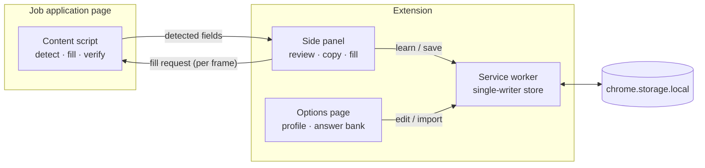

<div align="center">

# Application Autofill

**A privacy-first Chrome extension that fills job applications from your own answer bank, and never submits for you.**


<sub>Recorded on a live Greenhouse job with a fictional profile. Safe fields fill in one click. Sensitive questions are flagged for review. Nothing is submitted.</sub>

</div>

---

## Why I built it

As a final-year Software Engineering student applying to many UK graduate roles, I found that most application forms ask the same questions in slightly different words. "Will you require visa sponsorship?" and "Do you now or in the future need sponsorship?" have the same answer, but every form makes you type it again.

Browser autofill handles names and emails, but not free-text questions, custom dropdowns or right-to-work wording. Most "AI apply" tools work by sending your data to someone else's server. I wanted something that:

- **understands the question**, not just the field name
- **keeps every answer on my machine**
- **leaves the final decision to me**: it never clicks Submit, and sensitive questions always need a human

## What it does

| | |
|---|---|
| 🔍 **Detects every question** | Reads labels, ARIA attributes, placeholders and nearby text. Handles text inputs, textareas, selects, radio groups, checkboxes and custom React dropdowns. |
| 🧠 **Matches by meaning** | UK/US-spelling-aware normalisation, concept detection and fuzzy scoring. Paraphrased questions map to the same saved answer, with a visible confidence score. |
| ⚡ **Fills in one click** | Writes values the way React-controlled forms expect, and checks that each value actually stuck. |
| 🛡️ **Flags knockout questions** | Right to work, sponsorship, criminal record, disability and demographic questions get a ⚠ badge and are never bulk-filled. |
| 📚 **Learns as you go** | Every accepted answer teaches the bank a new wording, so the next form is instant. |
| 🔒 **Stays local** | Profile, answers and API keys live in `chrome.storage.local`. No backend, no analytics, no tracking. |

<table>
<tr>
<td width="40%" valign="top">

**Side panel**: every detected question with its matched answer, confidence, character limit and warnings.


</td>
<td width="60%" valign="top">

**Answer bank**: profile, saved answers, settings, and JSON backup/restore.


</td>
</tr>
</table>

## How it works



1. **Detect.** A platform adapter (Greenhouse today) layers platform knowledge on top of a generic DOM scanner: question text, dropdown options, help text and EEOC sections.
2. **Match.** Each question is normalised and scored against the profile and every saved wording in the answer bank. Concepts such as *sponsorship*, *right to work* or *notice period* carry most of the weight, so paraphrases still match. Company- or technology-specific questions ("Why Figma?", "Years of Python?") need close wording.
3. **Review.** The side panel shows every match with a confidence score. Sensitive, low-confidence, opposite-polarity and over-length answers are excluded from bulk fill.
4. **Fill and verify.** Values go in through native setters and real input events. Dropdown choices are confirmed against what the page actually shows.

## Engineering highlights

- **Works with real React forms.** Live testing showed that Greenhouse's dropdown wrapper only opens on `mouseup`/`keyup` and ignores synthetic `input` events. The filler reproduces the right event sequence and scopes option lookups to each dropdown's own listbox, because a phone widget keeps a hidden list of hundreds of country "options" in the page.
- **Survives framework hydration.** Greenhouse's page data (`__remixContext`) is removed while the page loads. The adapter caches it, or re-fetches the page once, so dropdown options are known before you open them.
- **Matching that knows what it doesn't know.** Without the polarity guard, "Can you work *without* sponsorship?" would get your "Do you need sponsorship?" answer, which means the opposite. That answer is capped and flagged instead. "Are you a US Person?" no longer matches UK right-to-work answers. Statement options like "I'm a citizen…" aren't treated as a "Yes".
- **Safe by construction.** The filler only ever clicks radios, checkboxes and dropdown options. It refuses buttons and links, never calls `submit()` and never sends Enter.
- **Concurrency-safe storage.** All writes go through one service-worker queue with field-level patches and conflict detection, so the panel and the options page can't overwrite each other. A versioned schema migrates v1 data, with an automatic backup first.
- **Privacy rules in code.** Demographic and disability answers, contact details and other companies' answers are filtered out before anything could reach an AI model, and tests enforce it.
- **Least-privilege permissions.** It runs automatically on Greenhouse only. Any other site needs a one-off, per-site permission.

## Testing

| Layer | What it covers |
|---|---|
| **Unit and regression** (Vitest, 130 tests) | Normaliser, matcher (paraphrase, polarity and false-positive cases), sensitive-question rules, limits, schema validation and migration, worker write races, privacy filters |
| **Real-page fixtures** | Detection runs against saved Greenhouse applications (Monzo: UK diversity survey; Figma: US EEOC) |
| **React integration** | Controlled inputs, selects, radios and react-select-style dropdowns rendered in jsdom. The tests assert that React state really changed and that no form was submitted. |
| **Extension smoke test** | Loads the built MV3 extension in headless Chromium and drives the real options page, worker and panel |
| **Live end-to-end** | `npm run media` records the demo above on a live Greenhouse job, with a network guard that blocks any application POST |

```sh
npm test            # unit + integration
npm run typecheck   # strict TypeScript
npm run test:mv3    # headless extension smoke test (after: npx playwright install chromium)
```

## Getting started

```sh
git clone https://github.com/AkoSuminoe/application-autofill.git
cd application-autofill
npm install
npm run build       # outputs dist/
```

1. Open `chrome://extensions` and turn on **Developer mode**.
2. Click **Load unpacked** and select `dist/`.
3. Fill in your profile on the options page that opens.
4. Open a Greenhouse application. Click the toolbar icon or press **Alt+Shift+F**.

## Tech stack

**TypeScript** (strict) · **Chrome Extensions Manifest V3** (side panel, service worker, scripting, optional host permissions) · **esbuild** · **Vitest** + **jsdom** (with React for integration tests) · **Playwright** · zero runtime dependencies, with no UI framework in the extension itself.

<details>
<summary><b>Project structure</b></summary>

```
src/
├── background/      service worker + single-writer storage queue
├── content/
│   ├── detect/      generic DOM scanner + per-ATS adapters (greenhouse.ts)
│   └── fill.ts      React-safe filling and verification
├── shared/          schema, normaliser, matcher, sensitive rules, limits, validation
├── sidepanel/       review UI
├── options/         profile, answer bank, settings, backup
└── llm/             system prompt + provider interface (privacy filter enforced)
tests/               unit, integration, fixtures, MV3 smoke test
scripts/             demo recorder
docs/                design notes and media
```

</details>

## Roadmap

- [x] Greenhouse: detection, matching, side panel, React-safe filling
- [x] Answer bank with import/export, scopes and schema migration
- [ ] AI drafting (Claude / OpenAI / Gemini, your own key, off by default) with a plain-British-English, no-invented-facts prompt
- [ ] Lever · Ashby · Workable · SmartRecruiters · Workday · LinkedIn Easy Apply
- [ ] Application tracker with CSV export

Detailed behaviour, scoping rules and lessons from live pages are in **[docs/DESIGN.md](docs/DESIGN.md)**.

## Privacy

Everything stays in your browser. There is no server and no telemetry. Exports leave API keys out unless you choose to include them. The demo media uses a fictional profile.

## License

[MIT](LICENSE)
