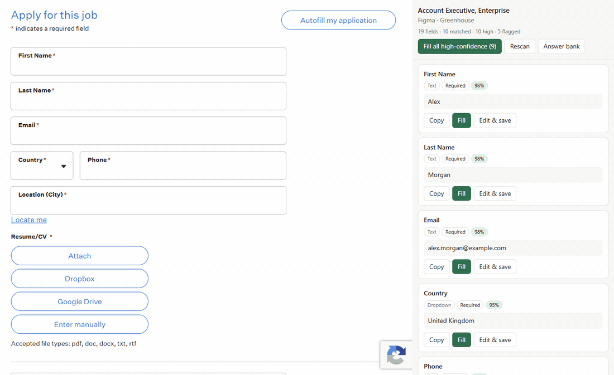
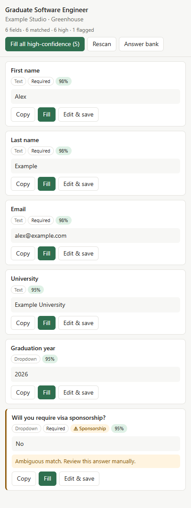
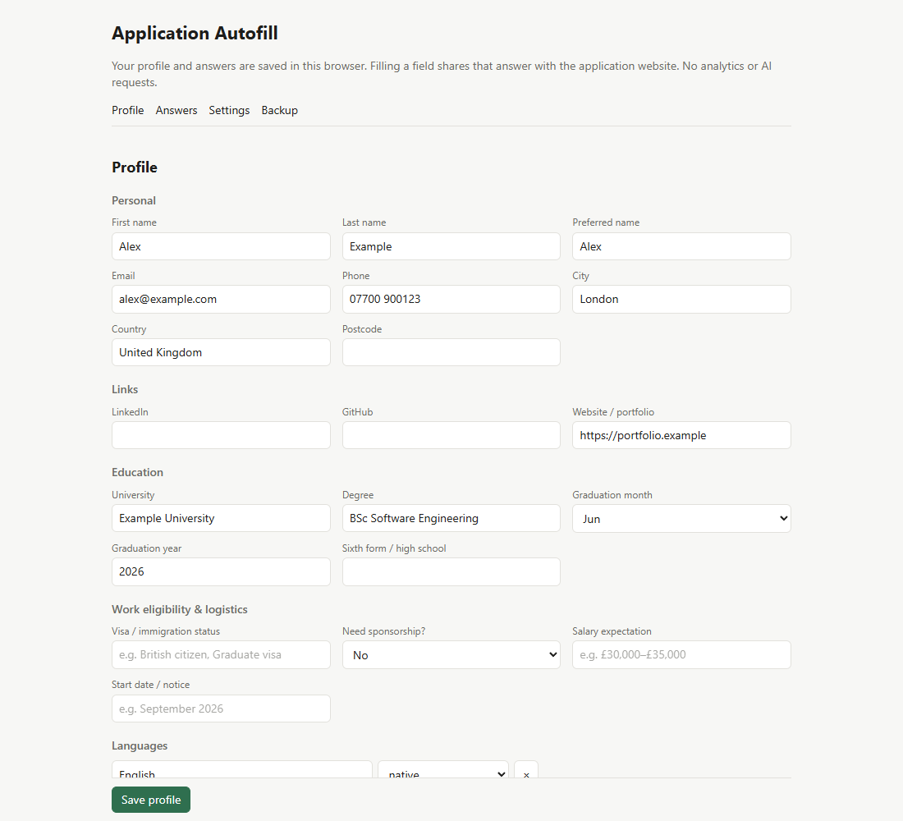
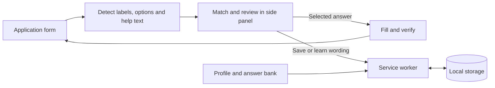

<div align="center">

# Application Autofill

### Your answers. Your browser. Your final say.

Fill repetitive job application fields from a local answer bank.<br>
Review sensitive questions yourself. Submit only when you are ready.

[](https://github.com/AkoSuminoe/application-autofill/actions/workflows/ci.yml)


[](LICENSE)

[Get started](#get-started) · [See the demo](#see-it-work) · [Tests](#tests-you-can-run) · [Privacy](#privacy-and-permissions)

</div>

## See it work



**[Watch or download the MP4](docs/media/demo.mp4)** · [Text captions](docs/media/demo.vtt)

The demo runs the **real built extension** against a bundled fictional vacancy. Five fields fill together; sponsorship stays empty until reviewed individually. The form is never submitted. Screenshots are composed into a short, captioned walkthrough.

All names, contact details and education shown are fictional. Recording uses a fresh browser profile, a locally intercepted form, and blocked external HTTP(S) traffic. It does not use personal browser data or contact a live employer.

## Why I built it

Job applications keep asking the same questions in slightly different words. Browser autofill helps with contact details, but leaves repeated free-text answers, education fields and eligibility questions to be entered again.

I built Application Autofill to reuse answers I have already written, show why each answer matches, and keep the final review in my hands. It works without an account, a backend or an AI subscription.

## What you can do

| Feature | What it does |
| --- | --- |
| **Reuse your profile** | Match names, contact details, links, education and other saved profile fields. |
| **Build an answer bank** | Save answers with multiple question wordings, tags and company-specific scopes. |
| **Review before filling** | See the suggested answer, matching score, limits and warnings beside the form. Scores are heuristics, not probabilities. |
| **Fill safe matches together** | Bulk fill skips sensitive questions, existing values, ambiguous matches, missing options and answers over the limit. |
| **Handle modern controls** | Fill native inputs, selects, radio groups, checkboxes and supported React-style dropdowns. Verify the resulting value. |
| **Keep company answers separate** | Motivation and other company-dependent answers require the appropriate company scope for automatic reuse. |
| **Learn successful wording** | A successful, unambiguous fill can add the new question wording to its saved answer. |
| **Back up your work** | Export JSON; merge or replace an imported bank with validation and conflict checks. API keys are excluded by default. |

<table>
  <tr>
    <td width="38%" valign="top">
      <b>Review beside the application</b><br><br>
      
    </td>
    <td width="62%" valign="top">
      <b>Your profile and answer bank</b><br><br>
      
    </td>
  </tr>
</table>

## Get started

**Requirements:** Node.js 24, npm, and Chrome 116 or newer. Node.js 24 was used for local verification and is configured in CI. This repository is loaded as an unpacked extension.

```sh
git clone https://github.com/AkoSuminoe/application-autofill.git
cd application-autofill
npm ci
npm run build
```

1. Open `chrome://extensions` and enable **Developer mode**.
2. Choose **Load unpacked** and select the generated `dist/` folder.
3. Add your details on the options page, then click **Save profile**.
4. Open a Greenhouse application and click the extension icon or press **Alt+Shift+F**.
5. Review the suggestions. Use **Fill all high-confidence** for eligible fields and **Fill** for individual answers.
6. Check the completed application and upload any required files yourself. Submit from the employer's page when ready.

For another HTTPS site, invoke the extension on that tab and select **Enable on this site**. Chrome will request access to that host. This permission persists until you revoke it in Chrome's extension settings.

After code changes, rebuild and reload the extension at `chrome://extensions`, then refresh the application page. `npm run watch` rebuilds TypeScript automatically; restart it after changing files in `static/`.

## Current support

| Area | Status |
| --- | --- |
| Greenhouse | Dedicated adapter, saved-page detection fixtures and local Chromium integration checks. Live sites can change. |
| Other HTTPS forms | Generic detection after per-site permission; compatibility depends on the controls and page structure. |
| Lever, Ashby, Workable, SmartRecruiters, Workday, LinkedIn Easy Apply | No dedicated adapters or verified end-to-end support yet. |
| CV and file uploads | Manual. |
| AI drafting | Not implemented. Settings and privacy-filter scaffolding exist, but no model requests are made. No API key is needed. |
| Application submission | Manual. The extension does not intentionally click submit buttons, navigate or send Enter. |

Sensitive detection is rule based and can miss unfamiliar wording. Closed shadow roots, unusual dropdowns, cross-origin frames without permission and dynamically changing forms may need manual completion. Always review the actual form before submitting.

## Privacy and permissions

The extension has **no backend, telemetry or analytics**. Profile, answers and optional stored keys live in `chrome.storage.local`; this storage is restricted to trusted extension contexts. Page content scripts receive the answer requested for a fill, rather than reading the full bank or keys directly.

**Filling a field shares its value with that website.** A site can observe input events or autosave before you press Submit. Local storage describes where the answer bank lives; it does not make answers inserted into a website private from that website. Local storage and exported JSON are not encrypted by this extension, and backups contain personal answers.

| Permission | Purpose |
| --- | --- |
| `storage` | Save your local profile, answers and settings. |
| `sidePanel` | Display the review panel. |
| `scripting` | Enable the content script on an explicitly approved site. |
| `activeTab` | Temporarily identify/access the tab after invoking the extension. |
| Four Greenhouse hosts | Detect forms automatically on the supported US/EU board hosts. |
| Optional HTTPS host access | Request a specific site when you choose **Enable on this site**. The manifest does not grant access to every site at install. |

The Greenhouse adapter may fetch the current job page once to recover dropdown definitions removed during hydration. AI drafting is disabled. Future AI support would require a separate, explicit data-sharing choice.

## Tests you can run

```sh
npm test                         # unit, regression and React integration tests
npm run typecheck                # strict TypeScript checks
npx playwright install chromium # one-time browser install
npm run test:mv3                 # builds, then tests the actual MV3 extension
```

| Layer | Evidence |
| --- | --- |
| **Unit and regression** | Normalisation, matching, polarity, company scope, limits, imports, migrations, write races and privacy filters. |
| **Saved Greenhouse fixtures** | Form detection, UK diversity questions and US EEOC sections. |
| **React integration** | Controlled text/select/radio/checkbox inputs and dropdowns update application state without submitting the form. |
| **Safety regressions** | Ambiguous checkbox answers are refused; descriptive text flags sensitive questions; changed text is not reported as a successful fill. |
| **Chromium MV3 smoke** | Real worker/options/panel, concurrent edits, multiple selections, company separation, denied content-script storage access, sender validation and no submission. |
| **Offline demo assertions** | Five expected values fill, sponsorship requires individual review, and no submission or network write occurs. |

The [GitHub Actions workflow](.github/workflows/ci.yml) runs type checking, the test suite and the Chromium smoke test on pushes and pull requests. Native toolbar interaction and permission-prompt acceptance are tested with API mocks; they still need a manual release check. The offline demo is not a claim of current live-site compatibility.

Review findings, fixes and local verification results are recorded in [docs/REVIEW.md](docs/REVIEW.md).

### Reproduce the GIF, video and screenshots

Install **FFmpeg** on your PATH and Playwright Chromium, then run:

```sh
npm run media
```

This builds the extension, loads [the fictional application fixture](tests/fixtures/demo-application.html), verifies the fill sequence, and produces `demo.gif`, `demo.mp4`, `demo.vtt`, `panel.png` and `options.png` in `docs/media/`. External job URLs are not accepted. The MP4 has no audio; captions are supplied separately and the walkthrough includes visible text.

## How it works



Detection combines a generic DOM scanner with an ATS adapter. Matching uses normalised wording, factual concepts and fuzzy scoring, with guards for negation, ambiguous answers and company scope. Native setters and input events support controlled forms; verification checks what the page retained.

All bank writes pass through a service-worker queue. Field-level patches preserve unrelated edits, conflicts keep the draft for review, and schema migration backs up older data before replacing it.

<details>
<summary><b>Project structure and stack</b></summary>

```text
src/
  background/     service worker and serialized storage operations
  content/        detection adapters, field filling and verification
  shared/         matching, schema, validation, privacy and storage helpers
  sidepanel/      review and fill interface
  options/        profile, answers, settings and backup
  llm/            future drafting interface and context filters
tests/            unit, React integration, browser smoke and HTML fixtures
scripts/          offline demo recorder
static/           manifest, HTML, CSS and extension icons
docs/             design notes, review results and demo media
```

TypeScript · Manifest V3 · esbuild · Vitest · jsdom · Playwright. React is used in integration tests; the extension itself has no runtime dependencies or UI framework.

</details>

For detailed matching, scoping and storage behaviour, see [the design notes](docs/DESIGN.md).

## Troubleshooting

| Symptom | Next step |
| --- | --- |
| No fields appear | Open the application form, refresh after loading the extension, then select **Rescan**. |
| Generic site cannot be enabled | Click the extension icon on that tab first. Use an HTTPS page and accept the specific host permission. |
| An answer is skipped | Check the sensitivity, company, ambiguity, length or already-filled warning on its card. |
| Dropdown selection fails | Choose the value on the page; unsupported controls can need manual completion. |
| Saving reports a conflict | Keep your draft, compare against the latest saved data, then reapply the intended change. |
| Browser tests cannot launch | Run `npx playwright install chromium`; on Linux CI, use `npx playwright install --with-deps chromium`. |
| Media recording cannot start | Check `ffmpeg -version` and install Playwright Chromium. |

## Roadmap

- [x] Greenhouse adapter and generic form detection
- [x] Profile, company-scoped answer bank and validated backups
- [x] Reviewed filling with regression and browser checks
- [x] Reproducible offline GIF/video walkthrough
- [ ] Dedicated adapters for more application platforms
- [ ] Opt-in AI drafting with explicit data-sharing controls
- [ ] Application tracker and CSV export

## Author and license

Built and maintained by **[AkoSuminoe](https://github.com/AkoSuminoe)**. Licensed under [MIT](LICENSE).
